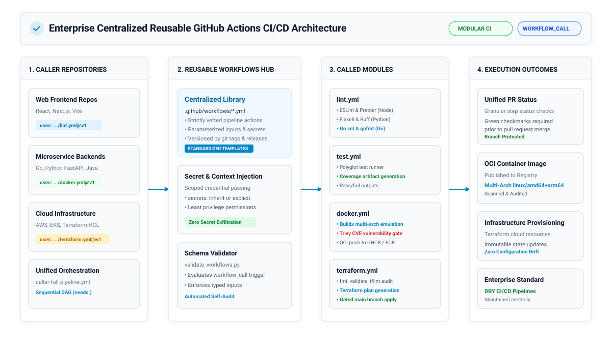

# Centralized Enterprise Reusable GitHub Actions Workflows

[](https://github.com/tayyabmasood911/github-actions-reusable-workflows/actions)
[](SECURITY.md)
[](LICENSE)
[](https://docs.github.com/en/actions/sharing-automations/reusing-workflows)

A centralized repository of enterprise-grade reusable GitHub Actions CI/CD workflows implementing DRY principles across code quality, testing, multi-architecture Docker container building, and Terraform infrastructure management.

---

## Architectural Blueprint

Consumer repositories invoke centralized, parameter-driven workflows via GitHub's `workflow_call` mechanism, inheriting standardized linting, security scanning, multi-architecture builds, and infrastructure automation.



---

## Workflow Catalog & Reference

| Workflow Path | Trigger | Primary Purpose | Key Technologies |
|:---|:---:|:---|:---|
| [`.github/workflows/lint.yml`](.github/workflows/lint.yml) | `workflow_call` | Polyglot code style and static syntax analysis | ESLint, Prettier, Flake8, Ruff, Go Vet |
| [`.github/workflows/test.yml`](.github/workflows/test.yml) | `workflow_call` | Automated test suite execution & coverage reporting | Jest, Pytest, Go Test, Coverage.py |
| [`.github/workflows/docker.yml`](.github/workflows/docker.yml) | `workflow_call` | Multi-arch Docker Buildx, Trivy scan, OCI registry push | Buildx, QEMU, Trivy, GHCR/ECR |
| [`.github/workflows/terraform.yml`](.github/workflows/terraform.yml) | `workflow_call` | Format check, TFLint security analysis, plan & apply | Terraform CLI, TFLint, AWS Provider |

---

## Consumer Usage Examples

### 1. Ingesting Reusable Lint & Test Workflows
In any calling repository, create `.github/workflows/ci.yml`:

```yaml
name: Application CI
on: [push, pull_request]

jobs:
  lint:
    name: Code Linting
    uses: tayyabmasood911/github-actions-reusable-workflows/.github/workflows/lint.yml@main
    with:
      language: "node"
      node-version: "20.x"

  test:
    name: Unit Testing
    needs: lint
    uses: tayyabmasood911/github-actions-reusable-workflows/.github/workflows/test.yml@main
    with:
      language: "node"
      coverage-threshold: 80
```

### 2. Multi-Arch Docker Build & Security Scan
```yaml
  build-container:
    needs: test
    uses: tayyabmasood911/github-actions-reusable-workflows/.github/workflows/docker.yml@main
    with:
      image-name: "my-org/my-service"
      image-tag: ${{ github.sha }}
      push: true
      registry: "ghcr.io"
      scan-severity: "CRITICAL"
    secrets:
      registry-username: ${{ github.actor }}
      registry-password: ${{ secrets.GITHUB_TOKEN }}
```

### 3. Terraform Cloud Infrastructure Pipeline
```yaml
  terraform-ci:
    uses: tayyabmasood911/github-actions-reusable-workflows/.github/workflows/terraform.yml@main
    with:
      terraform-version: "1.7.5"
      working-directory: "terraform/environments/prod"
      auto-apply: false
    secrets:
      aws-access-key-id: ${{ secrets.AWS_ACCESS_KEY_ID }}
      aws-secret-access-key: ${{ secrets.AWS_SECRET_ACCESS_KEY }}
```

---

## Local Verification & Testing

```bash
# Validate workflow YAML schemas and workflow_call trigger configurations
python3 scripts/validate_workflows.py

# Execute Python unit test suite
python3 -m unittest discover -s tests -p "test_*.py"

# Run healthcheck
bash scripts/healthcheck.sh
```

---

## Security Governance & Disclosure

For security disclosures or pipeline policy recommendations, review our [Responsible Disclosure Policy](SECURITY.md) or contact **Tayyab Masood** at [tayyabmasood911@gmail.com](mailto:tayyabmasood911@gmail.com).

---

## License

Licensed under the MIT License. See [LICENSE](LICENSE) for details.
